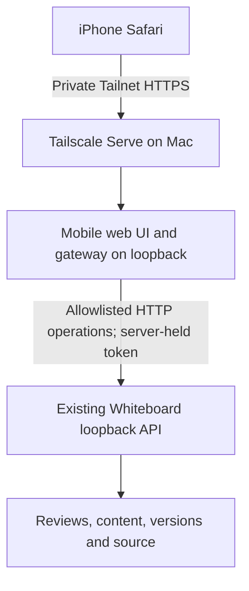

# Mobile Whiteboard v1

Status: design confirmed by the user on October 19, 2026, after six design questions. Implementation is in progress; the acceptance checks below remain outstanding until verified.

The Go gateway and React mobile entry are implemented. Local builds, type checks, Go race tests/vet, 22 behavior tests and root lint/format pass. WebKit and Chromium phone emulation passed the rich reader, drafts/conflicts, source and Changes flows. GET-only checks against running Whiteboard 0.3.1 passed, including a real review in WebKit. Independent review, private deployment and a physical iPhone check remain pending; no Tailscale routes have changed. See [current work](../CONTEXT.md) and [run instructions](mobile-whiteboard-run.md).

## Agreed scope

1. The Mac hosts Whiteboard and the companion. It must be awake, connected to Tailscale, and running the required services during phone access (Q1).
2. iPhone Safari can list and open reviews, read text and diagrams, inspect files and diffs, and edit review content where Whiteboard already supports it (Q2, Q6). Repository source files stay read-only.
3. Access is private to the user's Tailnet through Tailscale Serve over HTTPS; public sharing and Funnel are excluded (Q3).
4. v1 is content-only: no agent prompts or controls, shell execution, desktop/session controls, or arbitrary API passthrough (Q4, Q6).
5. Safari talks to a small mobile gateway on the Mac. The gateway keeps the Whiteboard token on the Mac and restricts reads and writes to explicit mobile operations. Live updates reconnect after interruptions (Q5, Q6).

## Architecture

Whiteboard owns persistence and validation. Reuse its API rather than invoking CLI subprocesses or exposing MCP to Safari. The gateway serves the UI and browser API from one origin. It validates method, route, query and write payload; an allowed `/commands` path alone is insufficient because the operation inside it can perform other actions.

The companion is a separate application boundary. It reuses the existing rich renderers through a small mobile session adapter. Desktop runtime validation remains unchanged; v1 does not mount or change the desktop application.

## Verified integration facts

Inspected at repository commit `38a6dad3049993f987d9b82ca3c5fee424b28f6b` (desktop source version 0.3.2). Earlier live inspection reported Whiteboard app/CLI 0.3.1; that is not proof the running host matches this checkout. Verify supported endpoints and schemas against the running host before implementation acceptance.

- The [API contract](../packages/review/src/review-api/README.md) covers review lists, snapshots, resources, source files, diffs, history and command-based document edits. `/watch` sends newline-delimited JSON, including current snapshots on connection; it is not an SSE endpoint.
- The [HTTP implementation](../packages/review/src/review-api/http.ts) also contains agent routes. A generic reverse proxy would expose more authority than v1 allows.
- [Server authentication and CORS](../packages/review/src/server/hono-http.ts) accept `x-review-token` or a query token and reflect origins. The mobile gateway must keep that credential out of browser URLs, storage and responses, and apply its own same-origin policy.
- The [desktop server](../packages/review/src/server/desktop-server.ts) binds to `127.0.0.1`; [remote-host documentation](remote-hosts.md) assumes loopback behind SSH forwarding. The mobile connection needs its own private gateway boundary.
- The desktop discovery record uses protocol version **3**, as declared in [the shared contracts](../packages/review-protocol/src/contracts.ts). The review-list HTTP path is `/reviews-api` without a trailing slash. Both were checked against the running desktop.
- The [canvas session](../packages/review/app/src/host/review-session.tsx) requires `ReviewCanvasBridge`. Existing rendering components cannot be assumed to run unchanged in Safari.

[Tailscale Serve documentation](https://tailscale.com/docs/reference/tailscale-cli/serve) describes private Tailnet access and distinguishes public Funnel access. Check the installed client's syntax, Serve configuration and Tailnet access rules before changing configuration. Preserve any existing Serve services.

## First implementation slice

1. Verify a running Whiteboard's discovery, credentials, representative review snapshot and content-edit schema. Build a narrow gateway with explicit reads and content edits; reject every other operation by default.
2. Build the phone review list and reader. Render existing text, diagrams, source and diffs; add explicit save for supported review-content fields. Keep unsupported content readable without replacing or dropping it.
3. Poll current snapshots every three seconds while visible and reload on Safari resume, focus or network recovery. Keep unsaved drafts separate from incoming updates and show stale/unavailable/failed-save states. The bounded gateway watch route remains available, but the mobile UI uses polling.
4. Validate the complete flow on iPhone Safari over Tailscale, including a content edit becoming visible in desktop Whiteboard and a desktop edit reaching Safari.

## Save and access requirements

Whiteboard currently has no expected-version write parameter: later edits to the same field win. Compare the draft's starting version with a fresh snapshot before save and require reconciliation when it changed; retain the draft on failure. That check is best-effort and cannot prevent a write racing between comparison and save. Do not promise atomic conflict protection or blindly retry an edit after a lost response; inspect the saved result first.

The gateway must keep both its listener and Whiteboard on loopback, use a fixed trusted upstream, limit request bodies and validate paths. Reject unexpected Host/Origin values and cross-origin writes; do not relay Whiteboard's permissive CORS headers or arbitrary client credentials. Tailnet access rules must restrict who can reach the service. Content is untrusted: render it without allowing scripts or unsafe URLs. No offline write queue is included in v1.

## Acceptance checks

- A real iPhone opens reviews, diagrams and readable source/diffs over private HTTPS with touch, narrow layouts and usable focus/labels.
- A supported content edit persists in Whiteboard; failed saves and concurrent changes preserve the phone draft and give clear feedback. Viewing source never offers a source-write operation.
- Refresh/resume converges to current content without duplicating edits. A stopped host shows an unavailable state.
- Unknown routes and operations, agent/desktop/shell controls, hostile origins, oversized inputs and upstream URL injection are rejected. No Whiteboard token reaches Safari or logs.
- Existing desktop and CLI/MCP behavior still works. The phone endpoint is unavailable outside the authorized Tailnet path; Funnel is not enabled.

Local implementation and browser-emulation results are recorded above; private HTTPS and physical iPhone acceptance remain open.

## Open implementation questions

No further product interview is needed. The user approved a Go gateway with the existing TypeScript/React UI on 2026-10-19, to reuse Whiteboard's rich renderers. Verify renderer reuse, the exact initial editable content fields, local discovery/version compatibility and current Serve/access configuration from source and representative host data. These are implementation investigations, not approval to add features.

Next step: obtain separate combined review of `mobile-flow` on `codex/mobile-flow`, then publish the PR and configure private access after acceptance. Architecture rationale is in [ADR-0001](adr/0001-mobile-companion-boundary.md); vocabulary is in the [glossary](../GLOSSARY.md).
